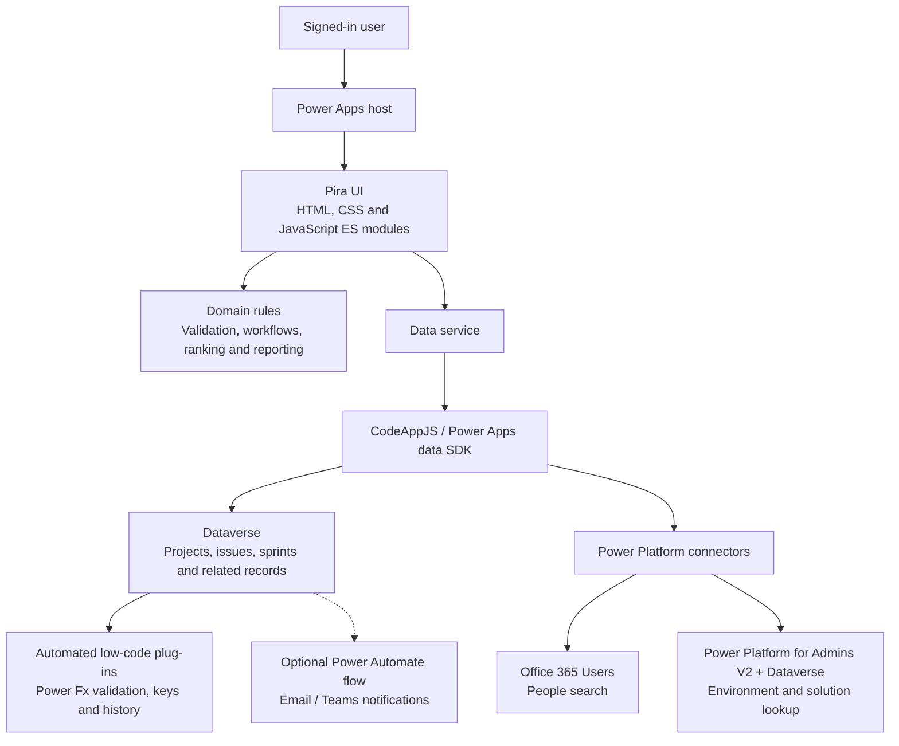

# Pira

**Jira-inspired work management, built on Microsoft Power Platform.**

Pira is a Power Apps Code App for managing projects, issues and agile delivery, with Dataverse as its source of truth. It brings boards, backlogs, sprints, team collaboration and release tracking into one app, with Power Platform solution visibility alongside the work.

The app is built with **CodeAppJS**, using plain HTML, CSS and JavaScript ES modules rather than React or a frontend build pipeline.

- **How it was built:** [Read the blog post](https://dev.to/wyattdave/pira-creating-my-own-jira-in-code-apps-2gd4) 
- **Framework:** [CodeAppJS Docs](https://codeappjs.com/)
- **Server-side plug-in tooling:** [Dataverse-Plugins-Native](https://github.com/wyattdave/Dataverse-Plugins-Native)

## What the app does

### Projects and issue tracking

- Create projects with Kanban, Scrum or bug-tracking workflow templates.
- Manage project membership with lead, contributor and stakeholder roles.
- Track epics, stories, tasks and bugs with readable issue keys, priorities, assignees, due dates and labels.
- Organise work into an **Epic > Story > Task/Bug** hierarchy, with issue relationships and dependency views.
- Use Your Work, project issue lists, global search and issue deep links to find work quickly.
- Add comments, mentions and attachments, and review issue history.
- Switch between dark and light themes.

### Agile delivery

- Plan and rank work in the backlog.
- Use Kanban and Scrum boards, with multiple boards per project.
- Estimate with story points and manage the sprint lifecycle.
- Review sprint outcomes, epic progress and project dashboards.
- Configure project workflows, allowed transitions and required fields.

### Team productivity

- Save personal or project-shared filters.
- Bulk-edit issues with a preview and per-issue results.
- Define project custom fields: text, number, date, yes/no and single choice.
- Receive in-app notifications for assignments, mentions and other work updates.
- Configure notification preferences, with optional email and Teams delivery through Power Automate.
- Search for people through the Office 365 Users connector.

### Releases, reporting and Power Platform integration

- Track estimates, remaining effort and work logs.
- Manage versions, fix versions, releases and a release calendar.
- Build advanced queries with a visual query builder.
- View lead/cycle time, throughput, overdue work, sprint outcomes and estimate accuracy.
- Export issues to CSV and import new issues with a dry-run preview.
- Visualise dependencies between issues.
- Link an epic to a Power Platform solution in **Dev, Test, Stage and Prod**.
- View live solution versions and modified dates, and open linked solutions in the maker portal.
- Record a solution version on a story and compare it with the solution linked to its parent epic.

## Architecture overview

Pira separates the user interface, reusable domain rules and data access. Power Apps provides the managed host and signed-in user context; Dataverse stores the application data and runs the server-side rules.

### Application layers

| Layer | Responsibility | Location |
| --- | --- | --- |
| App shell | Startup, navigation, routing, global search and theme | [dist/index.html](dist/index.html), [dist/index.js](dist/index.js) |
| UI modules | Boards, backlog, issue panel, project settings, reports and other views | [dist/js/ui](dist/js/ui) |
| Domain logic | Reusable validation, workflow rules, ranking, query translation and calculations | [dist/js/domain.js](dist/js/domain.js) |
| Data service | Dataverse and connector access, including server-side filtering, selected columns and paging | [dist/js/data-service.js](dist/js/data-service.js) |
| Runtime and connectors | CodeAppJS helpers, Power Apps SDK and connector wrappers | [dist/codeapp.js](dist/codeapp.js), [dist/power-apps-data.js](dist/power-apps-data.js), [dist/connectors](dist/connectors) |
| Configuration | Table mappings, choices, workflow templates, feature flags and app manifest | [dist/config/app-config.js](dist/config/app-config.js), [power.config.json](power.config.json) |
| Server-side rules | Power Fx formulas and deployment specifications for low-code plug-ins | [plugins](plugins), [plug-in guide](docs/lowcode-plugins.md) |

The [dist](dist) directory is deployed as-is; there is no frontend compilation step. The data model contains **23 custom Dataverse tables**, plus the standard User table. See the [schema and ERD](docs/dataverse-schema-erd.md) for the relationships.

### Server-side behaviour

The default configuration is `SERVER_LOGIC = 'lowcode'`. Dataverse automated low-code plug-ins enforce record-level rules such as issue key allocation, valid workflow transitions, project membership checks, immutable fields and issue history. The browser also validates early to give users useful feedback, but it is not the security boundary.

Use **[Dataverse-Plugins-Native](https://github.com/wyattdave/Dataverse-Plugins-Native)** to check and deploy the low-code plug-ins. Pira's [plug-in guide](docs/lowcode-plugins.md) describes the rules, deployment steps and limitations. These are Power Fx low-code plug-ins, not C# assemblies.

Optional Power Automate delivery is outside the critical path for core issue updates. The solution integration reads environment and solution information as the signed-in user; it does not deploy solutions between stages.

## Getting started

Pira needs a Power Platform environment with Dataverse, access to Power Apps Code Apps and appropriate permissions to configure tables, security roles, connections and plug-ins.

1. **Review the Code Apps workflow.** Follow the [CodeAppJS Docs](https://codeappjs.com/) for app setup, hosting and publishing.
2. **Prepare Dataverse.** Follow the [Dataverse setup guide](docs/dataverse-setup.md) to provision the tables and columns, configure alternate keys and assign the Pira User security role. The [table definitions](dist/config/dataverse-tables.json) and [schema overview](docs/dataverse-schema-erd.md) describe the data model.
3. **Deploy the plug-ins before using the app.** Use [Dataverse-Plugins-Native](https://github.com/wyattdave/Dataverse-Plugins-Native) with the sources in [plugins](plugins), following the [Pira plug-in guide](docs/lowcode-plugins.md).
4. **Configure the app for your environment.** Replace `<ENVIRONMENTID>` in [power.config.json](power.config.json), verify the Dataverse mappings and configure the Office 365 Users, Power Platform for Admins V2 and Microsoft Dataverse connections.
5. **Publish and share the Code App.** Deploy the [dist](dist) directory using the CodeAppJS publishing workflow. Users need the relevant Dataverse privileges and connector access, and may be prompted to approve connections.
6. **Optionally enable email/Teams notifications.** Follow the [notification flow guide](docs/notification-flow.md).
7. **Walk through the acceptance checks.** Use the manual test guides below to validate the app in your environment.

Advanced capabilities can be switched on or off with `FEATURES` in [app-config.js](dist/config/app-config.js).

## Important limitations

- **Preview dependency:** automated low-code plug-ins are documented as a Microsoft preview feature in the setup notes. Check Microsoft's current support status and suitability before relying on them for production workloads.
- **Read access:** project membership checks on writes do not provide project-level read isolation. With the documented organisation-wide Read privileges, UI filtering is not a security boundary; isolated projects need an appropriate Dataverse owner-team or sharing design.
- **Client fallback:** `SERVER_LOGIC = 'client'` exists for development/setup scenarios, but does not provide server-side enforcement.
- **Multi-record operations:** bulk edits, workflow saves, sprint completion and releases are not single atomic transactions. Review partial failures and retry as directed by the app.
- **Bounded operations:** bulk edits support up to 50 issues; CSV imports up to 200 issues; attachments up to 10 MB each and 20 per issue.
- **Scope:** the advanced query builder is not JQL, and Pira does not promise Jira API compatibility. General-purpose automation rules are not implemented.
- **Notifications:** in-app notifications are polled rather than pushed; email and Teams require the optional flow.

## Documentation

| Guide | Contents |
| --- | --- |
| [Dataverse setup](docs/dataverse-setup.md) | Tables, keys, privileges and manual configuration |
| [Data model and ERD](docs/dataverse-schema-erd.md) | Table definitions and relationships |
| [Low-code plug-ins](docs/lowcode-plugins.md) | Current server-side implementation and deployment |
| [Security design](docs/security-roles.md) | Role recommendations and access considerations |
| [Notification flow](docs/notification-flow.md) | Optional email and Teams delivery |
| [Advanced capability design](docs/phase-4-design.md) | Reporting definitions and advanced feature decisions |
| [Phase 1 checks](docs/phase-1-manual-test.md) | Core projects, issues and boards |
| [Phase 2 checks](docs/phase-2-manual-test.md) | Agile delivery |
| [Phase 3 checks](docs/phase-3-manual-test.md) | Team productivity |
| [Phase 4 checks](docs/phase-4-manual-test.md) | Advanced capabilities |
| [Phase 5 checks](docs/phase-5-manual-test.md) | Power Platform solution integration |

## License

[MIT](LICENSE).
