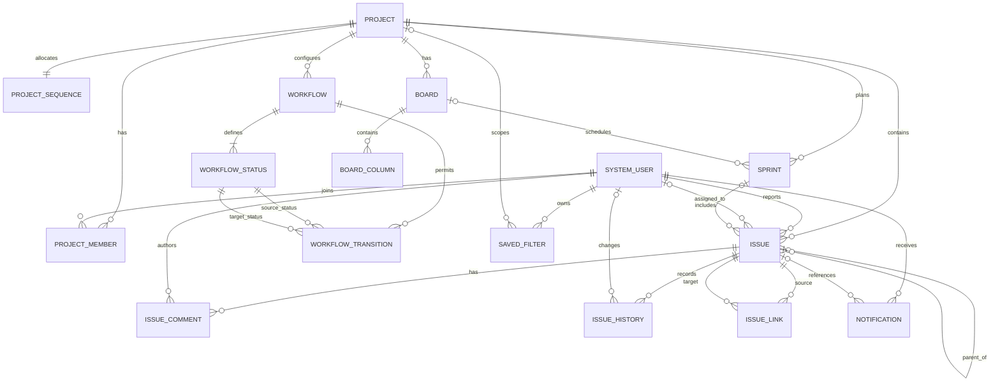

# Dataverse Table Schema and ERD

## Status and naming

This is a logical schema baseline, not a ready-to-import solution file. Replace `wm_` with the solution publisher prefix before implementation. Confirm actual logical names, ownership types, choice values, relationship behavior and alternate-key support in the target Dataverse environment.

Use Dataverse GUID primary keys internally. Use readable issue keys only as immutable display identifiers. Enable auditing on important tables/columns where required.

## Core tables and columns

### Project (`wm_project`)

- `wm_projectid` — primary key (GUID)
- `wm_name` — text, required
- `wm_key` — text, required, uppercase, unique alternate key, immutable after first issue
- `wm_description` — multiline text
- `wm_projecttype` — choice (Kanban, Scrum, General)
- `wm_lead` — lookup to System User
- `wm_state` — choice (Active, Archived)
- `wm_nextissuesequence` — whole number only if using a single-row counter design; prefer dedicated sequence table for concurrency-safe allocation
- `ownerid` — Dataverse owner where applicable
- Created/modified fields — Dataverse standard fields

### Project Member (`wm_projectmember`)

- `wm_projectmemberid` — primary key
- `wm_projectid` — required lookup to Project
- `wm_systemuserid` — required lookup to System User
- `wm_projectrole` — choice (Lead, Contributor, Stakeholder)
- `wm_membershipstate` — choice (Active, Removed)
- `wm_joinedon`, `wm_removedon` — date/time
- Alternate key on Project + User if only one membership row per user/project is maintained; otherwise enforce a unique active membership strategy.

### Project Sequence (`wm_projectsequence`) — recommended

- `wm_projectsequenceid` — primary key
- `wm_projectid` — required lookup to Project, unique alternate key
- `wm_nextnumber` — whole number
- `versionnumber` — Dataverse-managed row version where available

Use optimistic concurrency with bounded retry or a transactionally safe server-side design. Do not treat this sketch alone as a guarantee of atomic increments; test the actual plug-in/API implementation under concurrent load.

### Issue (`wm_issue`)

- `wm_issueid` — primary key
- `wm_projectid` — required lookup to Project
- `wm_issuesequence` — whole number, required
- `wm_issuekey` — text, required, unique alternate key (e.g. `APP-123`)
- `wm_summary` — text, required, length appropriate for UI/search
- `wm_description` — multiline text
- `wm_issuetype` — choice (Task, Bug, Story, Epic)
- `wm_statusid` — lookup to Workflow Status or choice for the simplest initial workflow; prefer a status table when statuses are configurable
- `wm_priority` — choice (Lowest, Low, Medium, High, Highest)
- `wm_reporterid` — lookup to System User
- `wm_assigneeid` — lookup to System User, optional
- `wm_parentissueid` — self-lookup to Issue, optional
- `wm_sprintid` — lookup to Sprint, optional
- `wm_storypoints` — whole number, nullable
- `wm_duedate` — date-only
- `wm_rank` — text or decimal ranking field; define a tested ordering strategy
- `wm_resolution` — choice or lookup, nullable until resolved
- `wm_resolvedon` — date/time
- `wm_archived` — yes/no if soft archive is used
- Standard owner, created/modified fields

### Board (`wm_board`)

- `wm_boardid` — primary key
- `wm_projectid` — required lookup to Project for initial single-project boards
- `wm_name` — text, required
- `wm_boardtype` — choice (Kanban, Scrum)
- `wm_isdefault` — yes/no
- `wm_filterdefinition` — multiline text containing a versioned, validated filter definition; never store executable code
- `wm_active` — yes/no

### Board Column (`wm_boardcolumn`)

- `wm_boardcolumnid` — primary key
- `wm_boardid` — required lookup to Board
- `wm_name` — text
- `wm_order` — whole number
- `wm_statusid` — lookup to Workflow Status, or explicit mapping to a status
- `wm_wiplimit` — optional whole number
- Alternate key: Board + Order or Board + Status as appropriate to the design.

### Workflow (`wm_workflow`)

- `wm_workflowid` — primary key
- `wm_name` — text
- `wm_projectid` — optional lookup; null may represent a reusable template
- `wm_isdefault` — yes/no
- `wm_active` — yes/no
- `wm_version` — whole number or version label

### Workflow Status (`wm_workflowstatus`)

- `wm_workflowstatusid` — primary key
- `wm_workflowid` — required lookup to Workflow
- `wm_name` — text
- `wm_code` — stable code (ToDo, InProgress, InReview, Done)
- `wm_order` — whole number
- `wm_category` — choice (To Do, In Progress, Done)
- `wm_isinitial` — yes/no
- `wm_isterminal` — yes/no
- Alternate key: Workflow + Code.

### Workflow Transition (`wm_workflowtransition`)

- `wm_workflowtransitionid` — primary key
- `wm_workflowid` — required lookup to Workflow
- `wm_fromstatusid` — lookup to Workflow Status
- `wm_tostatusid` — lookup to Workflow Status
- `wm_name` — text
- `wm_requiredfields` — validated JSON/configuration or normalized child rules; do not accept arbitrary field names from client calls
- `wm_active` — yes/no
- Alternate key: Workflow + From Status + To Status if only one transition per pair is supported.

### Sprint (`wm_sprint`)

- `wm_sprintid` — primary key
- `wm_projectid` — required lookup to Project
- `wm_boardid` — optional lookup to Board
- `wm_name` — text, required
- `wm_goal` — multiline text
- `wm_startdate`, `wm_enddate` — date-only
- `wm_state` — choice (Planned, Active, Completed, Cancelled)
- `wm_startedon`, `wm_completedon` — date/time
- `wm_completionnotes` — optional text

### Issue Comment (`wm_issuecomment`)

- `wm_issuecommentid` — primary key
- `wm_issueid` — required lookup to Issue
- `wm_authorid` — lookup to System User, set server-side
- `wm_body` — multiline text
- `wm_isedited` — yes/no
- `wm_editedon` — date/time
- Standard created/modified fields

### Issue History (`wm_issuehistory`)

- `wm_issuehistoryid` — primary key
- `wm_issueid` — required lookup to Issue
- `wm_changedbyid` — lookup to System User
- `wm_changedon` — date/time
- `wm_eventtype` — choice (Created, FieldChanged, Commented, Transitioned, Linked, SprintChanged, Archived)
- `wm_fieldlogicalname` — text, nullable
- `wm_oldvalue` / `wm_newvalue` — text snapshots; store IDs separately if structured relationships require them
- `wm_oldrecordid` / `wm_newrecordid` — optional text/GUID snapshot fields
- `wm_correlationid` — text/GUID for grouping related changes
- `wm_operationname` — text
- Restrict create/update/delete to trusted server-side operations/admin maintenance; history should normally be append-only.

### Issue Link (`wm_issuelink`)

- `wm_issuelinkid` — primary key
- `wm_fromissueid` — required lookup to Issue
- `wm_toissueid` — required lookup to Issue
- `wm_linktype` — choice (Blocks, RelatesTo, Duplicates)
- `wm_createdbyid` — lookup to System User
- Validate no self-links and define whether inverse relationships are stored once or as directional pairs.

### Saved Filter (`wm_savedfilter`)

- `wm_savedfilterid` — primary key
- `wm_name` — text
- `wm_owneruserid` — lookup to System User or use Dataverse owner
- `wm_projectid` — optional lookup to Project
- `wm_filterdefinition` — versioned, validated JSON representation of an allowlisted query tree
- `wm_visibility` — choice (Private, Project, SelectedUsers)
- `wm_active` — yes/no

If SelectedUsers sharing is required, add `wm_savedfiltershare` with lookups to Saved Filter and System User. Filter sharing never grants record access.

### Notification (`wm_notification`) — Phase 3

- `wm_notificationid` — primary key
- `wm_recipientid` — required lookup to System User
- `wm_issueid` — optional lookup to Issue
- `wm_type` — choice
- `wm_title` — text
- `wm_message` — text; avoid sensitive content if access may change
- `wm_createdon` — date/time
- `wm_readon` — date/time, nullable
- `wm_deliverystate` — choice (Pending, Sent, Failed, NotRequired)
- `wm_correlationid` — text/GUID

### Attachment metadata

Prefer native Dataverse file columns or SharePoint document integration rather than a custom base64 text field. If a custom attachment metadata table is needed, store issue lookup, filename, content type, size, storage reference, uploader and upload date. File access must follow the selected storage provider's authorization model.

### Later-phase tables

- `wm_customfielddefinition` — supported field metadata and type.
- `wm_customfieldvalue` — only if the selected custom-field architecture requires a separate value store; assess query/reporting trade-offs first.
- `wm_automationrule`, `wm_automationexecution` — Phase 4.
- `wm_worklog` — Phase 4.
- `wm_projectversion` — Phase 4.

## Mermaid ERD

`SYSTEM_USER` represents the Dataverse systemuser table and is shown as a logical external entity, not a custom table to create.

## Relationship and delete behavior

- Project → Issue: restrict delete; archive projects instead.
- Issue → Comment/History: avoid cascade delete if retention matters. History should be retained per policy.
- Issue → Parent Issue: prevent cycles in server-side logic.
- Issue → Sprint: when sprint completes, move incomplete work explicitly; do not rely on cascade behavior.
- Project → Member: removal should deactivate/revoke access, not silently erase audit trail.
- Issue Link: restrict delete of linked issues or define cleanup behavior explicitly.
- Workflow → Status/Transition: prevent deleting statuses referenced by issues or board columns; use migration/deactivation.

## Indexes and alternate keys

Evaluate alternate keys and indexes for:

- Project key (`wm_key`)
- Project + issue sequence
- Issue key (`wm_issuekey`)
- Project sequence's Project lookup
- Project Member Project + User
- Board Column Board + Order
- Workflow Status Workflow + Code
- Issue Link From + To + Type

Dataverse alternate-key restrictions and indexing behavior should be confirmed in the target environment. Do not create every suggested key blindly; validate uniqueness semantics and platform limits.

## Query patterns to design for

- Issues by project and status, ordered by rank.
- Issues assigned to current user, ordered by modified date or due date.
- Issues by sprint, ordered by rank.
- Comments/history by issue and timestamp descending.
- Active members by project.
- Workflow transitions by workflow and source status.
- Notifications for current user where unread.

Use server-side filters, selective columns, paging and query plans appropriate to Dataverse. Avoid loading full issue records, comments and history for every board card.
